# DB 스키마 (ERD v0.3)

2026-11-06 작성 · 2026-11-07 Supabase 적용 · 2026-11-07 지표 개편 반영 · 팀 아카츠키 · 데이터 담당

이 폴더가 DB 스키마의 **기준**이다. Spring 엔티티와 FastAPI 쿼리는 `schema.sql` 을 보고 작성한다.
v0.2(2026-10-28, 명세 v0.1 + v0.2 변경안 통합 18테이블)를 **실제 LG U+ 전처리 결과에 맞게** 고친 버전. 20테이블.

| 파일 | 용도 |
| --- | --- |
| `schema.sql` | Supabase(PostgreSQL) 에 실행한 DDL. 컬럼 설명은 `COMMENT ON`, 전 테이블 RLS |
| `02_postgis.sql` | 선택. 읍면동 경계 폴리곤 컬럼 (PostGIS 확장 켠 뒤). 아직 실행 안 함 |
| `erd-mysql-erdcloud.sql` | ERDCloud **가져오기 → SQL** 에 붙여넣는 MySQL 방언 (타입만 변환). 다이어그램 갱신용 |
| `migrations/YYYYMMDD_설명.sql` | 적용된 DB 에 순서대로 실행하는 변경 파일. 아래 "적용 이력" 참고 |

- ERDCloud 다이어그램: https://www.erdcloud.com/d/SWyGuqFiKzbiNGqX4
- 적재 스크립트: workation-data `src/load_db.py` (parquet 4개 → DB)
- 전처리 컬럼 정의: workation-data `docs/schema.md`

## 현재 상태 (2026-11-07)

- Supabase 프로젝트 `workation` (리전 ap-northeast-1 도쿄, PostgreSQL 17) 에 `schema.sql` 실행 완료.
- `load_db.py` 로 region 12 · dong 204 · population_hourly · population_demographic · dong_month_summary · dong_year_summary 적재 완료 (약 69 MB).
- `anon` / `authenticated` 롤의 테이블 권한은 전부 REVOKE 했고 기본 권한도 회수했다. 백엔드는 DB 커넥션(또는 service role) 으로만 접근한다.
- 접속 문자열은 커밋하지 않는다. 설정 방법은 이슈 #2 참고.
- `metric` / `dong_hourly` 는 비어 있다. FastAPI 점수 계산을 붙일 때 `metric_def` 시드와 함께 채운다.

### 적용 이력

| 파일 | 내용 | Supabase 적용 |
| --- | --- | --- |
| `schema.sql` (v0.3 초판) | 20테이블 생성 + RLS | 2026-11-07 |
| `migrations/20261107_metric-v0.3.sql` | 지표 개편: `dong.is_excluded` 추가·수동면 표시, metric_def/metric/dong_hourly 주석 교체 | 2026-11-07 |

## 지표 (명세 v0.3 변경안 3장)

`metric_def.metric_key` 에 들어갈 키. 시드 INSERT 는 아직 없고 FastAPI 가 점수 계산을 붙일 때 같이 넣는다.
원 명세 v0.1 의 `crowd` · `long_stay` · `night` · `hourly_curve` 키는 폐기.

| 키 | 지표 | 원값 (`metric.raw_value`) | 재료 (`dong_month_summary`) | scope | 점수 |
| --- | --- | --- | --- | --- | --- |
| `ease` | 시기 여유 | 월 혼잡 지수 = 해당 월 방문 ÷ 연중 최대 월 방문 × 100 | `vist_total`, `dong_year_summary.vist_max` | region | 역백분위 (혼잡 낮을수록 높음) |
| `quiet` | 동네 조용함 | 낮 유입 지수 = 평일 낮 체류 ÷ 평일 심야 체류 | `stay_weekday_day`, `stay_weekday_night` | dong + region 집계 | 역백분위 |
| `peer` | 또래 밀도 | 20~40대 방문 비율 (미상 제외) | `vist_2040_share` | dong + region 집계 | 백분위 |
| `overnight` | 숙박 성향 | 숙박 계수 — 분자·분모 미확정 (후보: (심야 체류 − 거주) ÷ 방문) | `stay_*_night`, `resd_total`, `vist_total` | region | 백분위 |
| `evening` | 저녁 활기 | 저녁 보행 ÷ 낮 체류 | `walk_weekday_evening`, `stay_weekday_day` | dong + region 집계 | 백분위 |
| `weekend_gap` | 주중·주말 차이 (보조) | 주말 낮 체류 ÷ 주중 낮 체류. 0.9~1.1 균형형 | `stay_weekend_day`, `stay_weekday_day` | region | 라벨만 |
| `peak_share` | 성수기 집중도 (보조) | 상위 3개월 방문 ÷ 연간 방문 (%) | 월별 `vist_total` | region | 비교 문장 |
| `local_life` | 생활권 지수 (보조) | (거주 + 직장) ÷ (거주 + 직장 + 방문). ≥ 70% 생활권 | `resd_total`, `wrk_total`, `vist_total` | dong | 태그만 |

- **종합 `value`** (워케이션 밸류) 는 프리셋 `quiet` / `lively` / `custom` 의 가중 평균이라 `metric` 에 저장하지 않고 FastAPI 가 요청 시 계산한다 (백엔드 결정 2026-11-06).
- 백분위·등급은 같은 scope(시군구 12 / 행정동 203), 같은 달 안에서. S 상위 25% / A / B / C 하위 25%.
- `dong.is_excluded = true` 인 행정동(수동면)은 백분위 모집단·등급·지도에서 빼고 화면에 "집계 제외" 로 표기한다. 재적재해도 플래그는 유지된다 (`load_db.py` 는 `dong_id` 만 upsert).
- `dong_hourly.index_100` (24시간 붐빔 곡선) 의 원천은 **보행인구** `population_hourly.walk_avg` 다.
- 보류: `app_user.provider` 의 `apple` 제거와 알림 설정 컬럼 3개는 모바일 Apple 로그인 결정(workation-mobile #2) 뒤에.

## v0.2 → v0.3 변경

| 항목 | v0.2 | v0.3 | 이유 |
| --- | --- | --- | --- |
| region / dong 키 | 행정표준 코드 `VARCHAR(10)` | 정수 대리키 `SMALLINT`. `region_id` 1~12, `dong_id` = region_id×100 + 시군구 내 가나다 순번 (101, 102 … 1226) | U+ 데이터에 코드가 없고 이름만 있음. 공식 코드는 `region.sigungu_code`, `dong.adm_code` 에 나중에 채움 |
| region 수 | 13 (전주 완산구·덕진구) | 12 (전주시 1개) | 데이터에 구 구분 없음 |
| dong 유일성 | `dong_id` 만 | `UNIQUE (region_id, dong_name)` | 송정동(강릉·동해), 중앙동(4곳), 서면(양양·순천) 처럼 이름이 겹침 |
| `raw_flow` | 원본 그대로 | **`population_hourly`** — 원본 합(`*_sum`) + 요일 횟수로 나눈 평균(`*_avg`) + `day_group`/`time_band` | 전처리 결과와 1:1. API 가 바로 평균 인구(명) 을 씀 |
| `raw_service` | 원본 그대로, `sex CHAR(1)` | **`population_demographic`** — 원본 누적(`*_sum`) + 일평균(`*_avg`), `sex` male/female/**unknown**, `age_group` under20…60plus/**unknown**, `is_unknown` | 미상 행을 버리지 않고 보관하기로 한 결정 반영 |
| (없음) | | **`dong_month_summary`** 읍면동×월 48지표, **`dong_year_summary`** 읍면동 연간 요약 | 추천 점수 재료. FastAPI 가 이걸 읽어 `metric` 을 계산 |
| 월 표현 | `DATE` (월 첫날) | `year SMALLINT` + `month SMALLINT` | parquet 컬럼과 동일, 조인·필터 단순 |
| 값 타입 | `NUMERIC` | `DOUBLE PRECISION` | 평균값이라 소수. 정밀도 불필요 |
| RLS | 없음 | 20테이블 전부 ENABLE, 정책 없음 | 프론트가 Supabase 직접 호출 안 함. anon 키로는 아무것도 못 읽게 |
| 사용자 FK | 기본 | `ON DELETE CASCADE` (즐겨찾기·팁·반응·답글·신고·투표), `SET NULL` (사진·공유카드·검색로그) | 탈퇴 처리 |
| 열거값 | 주석만 | `CHECK` 제약 | 오타 방지 |
| `dong.geom` | 본 DDL 안 | `02_postgis.sql` 로 분리 | Supabase 는 확장을 `extensions` 스키마에 두고, 경계 데이터는 아직 없음 |
| `dong.is_excluded`, `excluded_reason` (2026-11-07) | (없음) | 집계 제외 플래그 + 사유. 수동면 true | 명세 v0.3: 특수시설 패턴 행정동 제외, 203곳 백분위 |
| `metric_def` 키 (2026-11-07) | crowd, quiet, peer, long_stay, night + 보조 4 | ease, quiet, peer, overnight, evening + 보조 3 (주석만, 시드 없음) | 명세 v0.3 지표 개편 |

바뀌지 않은 것: metric_def / metric / dong_hourly / region_link / app_user / favorite / photo / tip / tip_reaction / tip_reply / report / metric_vote / share_card / nl_search_log 의 구조 (키 타입만 정수로). 2026-11-07 지표 개편도 컬럼 추가는 `dong` 2개뿐이고 나머지는 주석이다.

## 적재 흐름

```
LG U+ CSV 2종 ──preprocess.py──▶ parquet 4개 ──load_db.py──▶ region, dong,
   (workation-data)                                            population_hourly, population_demographic,
                                                               dong_month_summary, dong_year_summary
                                                                       │
                                                        FastAPI 점수 계산 ──▶ metric, dong_hourly
```

- `load_db.py` 는 region/dong 을 이름 기준 upsert, 데이터 4테이블은 한 트랜잭션에서 TRUNCATE + COPY. 다시 돌려도 id 가 안 바뀐다.
- 로컬 PostgreSQL 16 검증 (2026-11-06): DDL 적용 OK, 적재 2.4초, 재실행 OK, 요약 ↔ 시간대 원본 재계산 오차 1e-11, 총 용량 약 70 MB (population_hourly 63 MB).

## 다이어그램

`scope + unit_id` 는 region/dong 을 가리키는 논리 참조라 물리 FK 를 걸지 않는다 (점선).

```mermaid
erDiagram
  region ||--o{ dong : "소속"
  region ||--o{ region_link : ""
  dong ||--o{ population_hourly : "D1"
  dong ||--o{ population_demographic : "D2"
  dong ||--o{ dong_month_summary : ""
  dong ||--o{ dong_year_summary : ""
  dong ||--o{ dong_hourly : ""
  metric_def ||--o{ metric : ""
  metric_def ||--o{ metric_vote : ""
  region ||..o{ metric : "unit_id"
  dong ||..o{ metric : "unit_id"
  app_user ||--o{ favorite : ""
  app_user |o--o{ photo : "업로더"
  app_user ||--o{ tip : ""
  app_user ||--o{ tip_reaction : ""
  app_user ||--o{ tip_reply : ""
  app_user ||--o{ report : ""
  app_user ||--o{ metric_vote : ""
  app_user |o--o{ share_card : ""
  app_user |o--o{ nl_search_log : ""
  region ||--o{ tip : ""
  dong |o--o{ tip : "선택"
  region ||--o{ share_card : ""
  tip ||--o{ tip_reaction : ""
  tip ||--o{ tip_reply : ""
  region ||..o{ favorite : "unit_id"
  dong ||..o{ favorite : "unit_id"
  region ||..o{ photo : "unit_id"
  dong ||..o{ photo : "unit_id"
  region ||..o{ metric_vote : "unit_id"
  dong ||..o{ metric_vote : "unit_id"
  tip ||..o{ report : "target"
  tip_reply ||..o{ report : "target"
  photo ||..o{ report : "target"

  region {
    smallint region_id PK "1~12"
    varchar(20) sido_name "시도명"
    varchar(20) sigungu_name "시군구명 UNIQUE with sido"
    varchar(5) sigungu_code "행정표준 코드 (추후)"
    numeric area_km2
    text[] tags "coast mountain city"
  }
  dong {
    smallint dong_id PK "region_id*100+순번"
    smallint region_id FK
    varchar(30) dong_name "UNIQUE with region"
    varchar(10) adm_code "행정동 코드 (추후)"
    numeric area_km2
    boolean is_excluded "집계 제외 (수동면)"
    varchar(100) excluded_reason
  }
  population_hourly {
    smallint dong_id PK,FK
    smallint year PK
    smallint month PK "1~12"
    smallint dow PK "0=월..6=일"
    smallint hour PK "0~23"
    varchar(7) day_group "weekday weekend"
    varchar(7) time_band "night morning day evening"
    smallint weekday_count "4 or 5"
    double stay_sum "원본 합"
    double walk_sum
    double driv_sum
    double stay_avg "÷weekday_count 평균(명)"
    double walk_avg
    double driv_avg
  }
  population_demographic {
    smallint dong_id PK,FK
    smallint year PK
    smallint month PK
    varchar(7) sex PK "male female unknown"
    varchar(7) age_group PK "under20..60plus unknown"
    boolean is_unknown
    smallint days_in_month
    double resd_sum "원본 월 누적"
    double wrk_sum
    double vist_sum
    double resd_avg "÷(일수×24) 일평균(명)"
    double wrk_avg
    double vist_avg
  }
  dong_month_summary {
    smallint dong_id PK,FK
    smallint year PK
    smallint month PK
    double stay_weekday_day "x24: {stay|walk|driv}_{weekday|weekend}_{band}"
    double stay_weekday_all "x6: _{weekday|weekend}_all"
    double walk_share "도보÷(도보+차량)"
    double resd_total
    double wrk_total
    double vist_total "미상 포함"
    double vist_known "미상 제외"
    double vist_unknown
    double vist_age_20s "x6: under20..60plus"
    double vist_female
    double vist_male
    double vist_2040
    double vist_2040_share
    double vist_per_resd
  }
  dong_year_summary {
    smallint dong_id PK,FK
    smallint year PK
    smallint months "12"
    double resd_mean
    double wrk_mean
    double vist_mean
    double vist_max
    double vist_min
    double vist_std
    smallint vist_peak_month
    smallint vist_low_month
    double vist_peak_ratio "max÷min"
    double vist_cv "std÷mean"
    double vist_per_resd_mean
    double vist_2040_share_mean
    double stay_weekday_day_mean
    double walk_weekday_day_mean
    double walk_weekday_evening_mean
    double walk_weekend_all_mean
    double walk_share_mean
  }
  metric_def {
    varchar(20) metric_key PK "ease quiet peer overnight evening .."
    varchar(30) name_ko
    text description
    varchar(4) higher_is "good bad"
    boolean is_core
  }
  metric {
    varchar(6) scope PK "region dong"
    smallint unit_id PK "논리 참조"
    smallint month PK "0=연간"
    varchar(20) metric_key PK,FK
    double raw_value
    smallint score "0~100"
    char(1) grade "S A B C"
  }
  dong_hourly {
    smallint dong_id PK,FK
    smallint month PK
    varchar(7) day_group PK "weekday weekend"
    smallint hour PK
    smallint index_100 "보행인구, 최대=100"
  }
  region_link {
    serial link_id PK
    smallint region_id FK
    varchar(10) kind "support stay tour"
    varchar(100) title
    text url
  }
  app_user {
    uuid user_id PK "Supabase auth id"
    varchar(10) provider "kakao google apple"
    varchar(100) provider_uid "UNIQUE with provider"
    varchar(20) nickname
    text avatar_url
    timestamptz created_at
  }
  favorite {
    uuid user_id PK,FK
    varchar(6) scope PK "region dong"
    smallint unit_id PK "논리 참조"
    timestamptz created_at
  }
  photo {
    serial photo_id PK
    varchar(6) scope "region dong"
    smallint unit_id "논리 참조"
    smallint month "촬영월"
    text url "Supabase Storage"
    varchar(8) source "user tourapi team"
    varchar(100) credit
    uuid user_id FK "업로더"
    varchar(8) status "pending approved hidden"
    boolean is_featured
    timestamptz created_at
  }
  tip {
    serial tip_id PK
    uuid user_id FK
    smallint region_id FK
    smallint dong_id FK "NULL=지역 단위"
    smallint visit_month
    smallint stay_days
    varchar(300) body
    varchar(8) status "public hidden"
    timestamptz created_at
  }
  tip_reaction {
    int tip_id PK,FK
    uuid user_id PK,FK
    timestamptz created_at
  }
  tip_reply {
    serial reply_id PK
    int tip_id FK
    uuid user_id FK
    varchar(300) body
    varchar(8) status "public hidden"
    timestamptz created_at
  }
  report {
    serial report_id PK
    varchar(6) target_type "tip reply photo"
    int target_id "논리 참조"
    uuid user_id FK
    varchar(30) reason
    timestamptz created_at
  }
  metric_vote {
    uuid user_id PK,FK
    varchar(6) scope PK "region dong"
    smallint unit_id PK "논리 참조"
    smallint month PK
    varchar(20) metric_key PK,FK
    boolean agree
    timestamptz created_at
  }
  share_card {
    serial card_id PK
    uuid user_id FK "비로그인 NULL"
    smallint region_id FK
    smallint month
    jsonb conditions
    text image_url "1080x1350"
    timestamptz created_at
  }
  nl_search_log {
    serial search_id PK
    uuid user_id FK "비로그인 NULL"
    varchar(300) query
    jsonb parsed
    timestamptz created_at
  }
```



## 처음부터 다시 올리는 순서

새 Supabase 프로젝트를 만들거나 스키마를 통째로 초기화할 때.

1. Supabase 대시보드 → SQL Editor 에 `schema.sql` 전체 붙여넣고 실행 (약 1초).
2. Project Settings → Database → Connection string 에서 **Session pooler (포트 5432)** URI 복사. COPY 를 쓰므로 Transaction pooler(6543) 는 안 된다. 비밀번호에 `!`, `@` 같은 특수문자가 있으면 퍼센트 인코딩한다.
3. workation-data 레포에서
   ```bash
   uv pip install -e '.[db]'
   export DATABASE_URL='postgresql://postgres.<ref>:<pw>@aws-0-<region>.pooler.supabase.com:5432/postgres'
   python src/load_db.py --dry-run     # 변환만 확인
   python src/load_db.py               # 적재 (약 10초, 네트워크에 따라 다름)
   ```
4. 검증: Table Editor 에서 `dong` 204행, `population_hourly` 411,264행 확인.
5. `schema.sql` 은 최신 상태라 `migrations/` 는 다시 실행할 필요 없다. 단 데이터 UPDATE 가 든 migration(`20261107_metric-v0.3.sql` 의 수동면 플래그)은 적재 뒤에 한 번 더 실행한다.
6. (선택) Database → Extensions 에서 postgis 를 켠 뒤 `02_postgis.sql` 실행.

## 스키마 변경 규칙

1. **SQL 이 먼저.** 변경은 이 폴더에 SQL 로 올리고 PR 로 합의한다. Supabase 대시보드에서 손으로 고치고 끝내지 않는다. JPA `ddl-auto` 는 `validate` 이하로만 쓴다.
2. 변경 파일은 `migrations/YYYYMMDD_설명.sql` 로 추가하고, `schema.sql` 도 같은 PR 에서 최종 상태로 갱신한다. `schema.sql` 은 항상 "빈 DB 에 한 번에 실행하면 현재 스키마가 되는 파일" 이어야 한다.
3. 적용은 Supabase SQL Editor 에서 migration 파일을 실행한다. 실행한 사람이 PR 에 날짜를 남긴다.
4. 데이터 6테이블(region, dong, population_*, dong_*_summary) 의 컬럼을 바꾸면 workation-data 의 `load_db.py` 와 `docs/schema.md` 도 같이 고친다. `load_db.py --dry-run` 이 통과하는지 확인한다.
5. 사용자·콘텐츠 테이블을 바꾸면 Spring 엔티티 담당에게 알린다.
6. `erd-mysql-erdcloud.sql` 도 같은 PR 에서 고치고, ERDCloud 는 **가져오기 → SQL** 로 다시 그린다 (기존 다이어그램 덮어쓰기).
